 

&nbsp;
&nbsp;
&nbsp;

 

 

<table align="center" border="0">
<tr>
<td width="50%" valign="top">

### 👨‍💻 About

I'm a **Full Stack Developer** from Bhubaneswar who ships real products, not tutorials.

QuickNote started as a weekend notes app. I grew it into a full social platform with auth, real-time chat, payments, push notifications and SEO, every part designed, built and deployed by me.

- 🎯 Looking for a full-stack role where I **own features end to end**
- 🌱 Levelling up in **TypeScript, system design and performance**
- ⚡ Fun fact: every movie and book on QuickNote was added **by hand**

</td>
<td width="50%" valign="top">

### 🧭 How I work

| | |
|---|---|
| **Ship it** | Live product > perfect plan. Deploy, measure, improve. |
| **Keep it simple** | Fewer moving parts, fewer bugs. |
| **Design matters** | A feature isn't done until it feels good to use. |
| **Own it** | Frontend, backend, database, deploy, domain. All of it. |

</td>
</tr>
</table>

 

## 🟠 Featured · QuickNote

**A full-stack social platform for notes, cinema, books, clubs and messaging.**
Live at **[quicknote.co.in](https://www.quicknote.co.in)**

<table align="center">
<tr>
<td align="center" width="25%">

**💬 Social** 
Feed · likes · comments & replies follow / private accounts notifications · @mentions

</td>
<td align="center" width="25%">

**🎬 Cinema & Books** 
discovery · ratings cast & crew pages news & discussions

</td>
<td align="center" width="25%">

**⚡ Real-time** 
Socket.io messaging Firebase push notifications optimistic UI

</td>
<td align="center" width="25%">

**🔐 Auth & Payments** 
email OTP · JWT · bcrypt rate limiting Razorpay premium badges

</td>
</tr>
</table>

**React · Node.js · Express · MongoDB Atlas · Socket.io · React Query · Framer Motion · Cloudinary · Vercel · Render · Cloudflare**

 

## 🛠️ Stack

**Frontend**

**Backend & Data**

**Tools & Deploy**

 

## 📂 Projects

| | Project | What it is | |
|:-:|---|---|:-:|
| 🟠 | **QuickNote** | Full-stack social platform — notes, cinema, books, clubs, real-time messaging, payments | [**Live ↗**](https://www.quicknote.co.in) |
| 💼 | **Portfolio** | Personal engineering site · React, TypeScript, Tailwind CSS | [**Live ↗**](https://omjyotiprakash.vercel.app) |
| 🌱 | **React Portfolio** | My first React build, where it all started | [**Live ↗**](https://omjyotiprakashreactportfolio.netlify.app/) |

 

## 📊 GitHub

  

 

## 📫 Let's build something

**Open to full-stack developer opportunities.** Role, freelance project, or just want to talk code — my inbox is open.

&nbsp;

 

